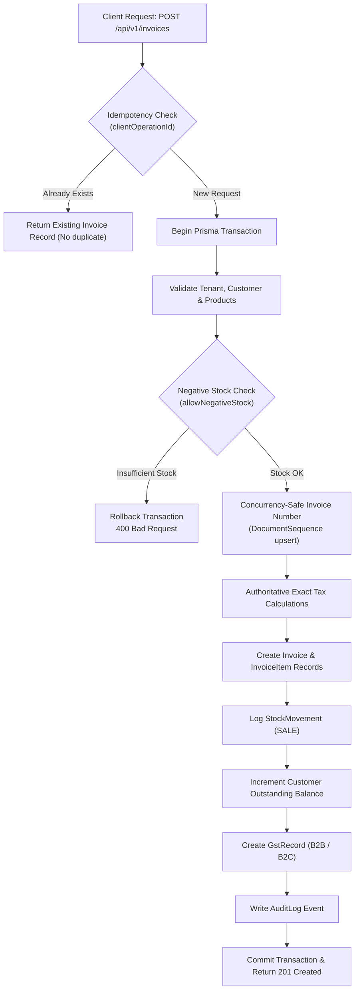

# Sales & Invoicing Engine API Specification

The AirthAI Sales and Invoicing engine provides an end-to-end commercial workflow for MSMEs, including **Quotations**, **Tax Invoices**, **Concurrency-Safe Sequential Numbering**, **Exact GST Calculations**, **Automated Stock Deductions**, and **Cancellation Reversals**.

---

## 1. Statutory Tax Assumptions & Legal Compliance Notice

> [!WARNING] Legal & Accounting Compliance Notice
> The calculations and GST business rules documented here follow standard Indian Goods and Services Tax (GST) principles under the CGST, SGST, and IGST Acts (2017). They reflect standard commercial software implementation practices.
> **Before deploying to production or claiming formal legal/tax compliance, an authorized chartered accountant or certified GST practitioner must review and certify the business settings, tax matrices, place of supply rules, and invoice formats.**

### Supported Tax Rules & Assumptions:
1. **Intra-State Supply**:
   - Condition: `businessStateCode == placeOfSupply` (e.g. Supplier in Maharashtra `27` selling to Buyer in Maharashtra `27`).
   - Calculation: Total GST is split equally into **CGST (50%)** and **SGST (50%)**.
   - Formula:
     $$\text{CGST} = \text{Taxable Value} \times \left(\frac{\text{GST Rate}}{2 \times 100}\right)$$
     $$\text{SGST} = \text{Taxable Value} \times \left(\frac{\text{GST Rate}}{2 \times 100}\right)$$
     $$\text{IGST} = 0$$

2. **Inter-State Supply**:
   - Condition: `businessStateCode != placeOfSupply` (e.g. Supplier in Maharashtra `27` selling to Buyer in Gujarat `24`).
   - Calculation: Full tax is charged as **IGST (100%)**.
   - Formula:
     $$\text{IGST} = \text{Taxable Value} \times \left(\frac{\text{GST Rate}}{100}\right)$$
     $$\text{CGST} = 0, \quad \text{SGST} = 0$$

3. **Non-GST / Composition Scheme**:
   - If `businessSettings.enableGst == false` or `business.taxType == 'COMPOSITION'` or `taxType == 'UNREGISTERED'`, tax fields are set to `0.00`.

4. **Compensation Cess**:
   - When a product is subject to cess (e.g. luxury goods, automobiles), cess is calculated on the taxable value:
     $$\text{Cess} = \text{Taxable Value} \times \left(\frac{\text{Cess Rate}}{100}\right)$$

5. **Exact Arbitrary-Precision Decimal Arithmetic**:
   - All financial operations use arbitrary-precision decimal arithmetic via `Prisma.Decimal` (Decimal.js). IEEE 754 floating-point binary math (`float` or double) is strictly prohibited on authoritative monetary calculations.
   - Rounding mode: **Half-Up** (`Decimal.ROUND_HALF_UP`) to 2 decimal places at line levels.
   - Commercial invoice round-off: Rounding to the nearest integer rupee:
     $$\text{Round Off} = \text{Round}(\text{Total}) - \text{Total}$$

6. **Authoritative Server Calculation**:
   - The server completely ignores any totals, taxes, or subtotals transmitted by the Flutter client. The backend independently calculates all taxable amounts, discounts, taxes, round-off, and grand totals directly from verified database rates.

---

## 2. Transactional Atomicity & Concurrency Safety

Every invoice creation executes inside an atomic `prisma.$transaction`. If any step fails, the entire transaction rolls back cleanly.



### Concurrency-Safe Sequence Generation
Invoice numbers are generated tenant-scoped and fiscal-year-scoped using the `document_sequences` table:
- Unique constraint: `@@unique([businessId, documentType, fiscalYear])`.
- Atomic PostgreSQL upsert increments `nextNumber` safely under concurrent requests.
- Format: `INV-YYYY-YY-XXXX` (e.g., `INV-2026-27-0001`).

### Cancellation & Reversal Logic
An issued financial document is **never deleted**. When cancelled (`PATCH /api/v1/invoices/:id/cancel`):
1. `Invoice.status` is set to `CANCELLED`, recording `cancelledAt` timestamp and mandatory `cancellationReason`.
2. Customer receivable balance is decremented by the invoice balance.
3. Inventory is returned to stock via a `StockMovement` of type `SALE_RETURN` referencing `INVOICE_CANCEL`.
4. Associated `GstRecord.isCancelled` is marked `true`.
5. Audit log event `INVOICE_CANCELLED` is recorded.

---

## 3. API Endpoints

### 3.1 Invoices API (`/api/v1/invoices`)

#### `GET /api/v1/invoices`
Returns paginated, searchable, and filtered invoices.
- **Query Parameters**:
  - `search` (optional): Filter by invoice number, customer name, or phone.
  - `status` (optional): `ALL`, `ISSUED`, `PAID`, `PARTIALLY_PAID`, `CANCELLED`, `DRAFT`.
  - `customerId` (optional): Filter by specific customer UUID.
  - `startDate` / `endDate` (optional): Filter by date range (ISO string).
  - `page` / `limit` (optional): Pagination controls.

#### `POST /api/v1/invoices`
Atomically creates and issues a tax invoice.
- **Request Body**:
```json
{
  "customerId": "cust_123",
  "invoiceDate": "2026-10-25T10:00:00Z",
  "dueDate": "2026-11-24T10:00:00Z",
  "placeOfSupply": "27",
  "discountAmount": 100.0,
  "notes": "Thank you for your business!",
  "terms": "Payment due within 30 days.",
  "clientOperationId": "uuid-for-idempotency",
  "items": [
    {
      "productId": "prod_123",
      "description": "Industrial Safety Helmet",
      "hsnCode": "650610",
      "quantity": 10,
      "unitPrice": 450.0,
      "discountAmount": 50.0,
      "gstRate": 18.0
    }
  ]
}
```
- **Response `201 Created`**: Returns authoritative invoice object including computed taxes, totals, item lines, and customer details.

#### `GET /api/v1/invoices/:id`
Retrieves full details for a single invoice.

#### `PATCH /api/v1/invoices/:id/cancel`
Cancels an issued invoice and executes full financial and inventory reversals.
- **Request Body**:
```json
{
  "reason": "Customer cancelled order before dispatch."
}
```
- **Response `200 OK`**: Returns cancelled invoice object.

---

### 3.2 Quotations API (`/api/v1/quotations`)

#### `GET /api/v1/quotations`
Lists all quotations for the tenant.

#### `POST /api/v1/quotations`
Creates a quotation with sequential numbering (`QUO-YYYY-YY-XXXX`).

#### `GET /api/v1/quotations/:id`
Retrieves quotation details and line items.

#### `POST /api/v1/quotations/:id/convert-to-invoice`
Converts an accepted quotation directly into an issued tax invoice:
- Updates quotation `status` to `CONVERTED`.
- Generates official `Invoice`, stock movements, customer receivable, and GST records.
- Returns the newly created `Invoice` object.
