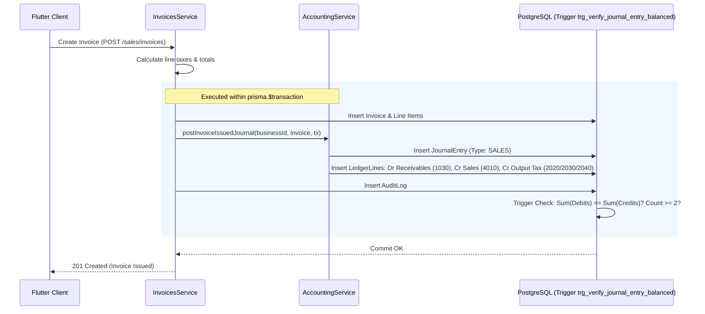

# AirthAI Double-Entry Accounting & GST Reporting Architecture

## 1. Accounting Framework & Architectural Principles

AirthAI MSME Business OS incorporates an authoritative, double-entry general ledger engine engineered specifically for Indian Micro, Small, and Medium Enterprises (MSMEs). The engine adheres strictly to fundamental accounting principles, Indian Accounting Standards (Ind AS) / AS guidelines, and Goods and Services Tax (GST) reporting requirements.

### 1.1 Core Principles
1. **Mathematical Invariant — Strict Double-Entry Balance:** Every journal entry consists of at least two ledger lines where total debits strictly equal total credits:
   $$\sum_{i=1}^{n} \text{Debit}_i = \sum_{j=1}^{m} \text{Credit}_j$$
   Entries violating this invariant are rejected at the application level and blocked by database-level triggers.
2. **Database Trigger Enforcement:** PostgreSQL enforces double-entry balance at the storage engine level via the trigger `trg_verify_journal_entry_balanced` on the `ledger_entries` table. Configured as `CONSTRAINT TRIGGER ... DEFERRABLE INITIALLY DEFERRED`, this check evaluates at transaction commit time, independently verifying line count ($\ge 2$) and zero balance difference before committing any transaction.
3. **Arbitrary-Precision Decimal Representation:** All financial values, unit rates, tax amounts, debit balances, and credit balances utilize PostgreSQL `DECIMAL(14, 2)` mapped directly to `Prisma.Decimal`. Binary IEEE-754 floating-point arithmetic is strictly prohibited in financial calculations.
4. **Immutability and Audit Integrity:** Posted journal entries are strictly immutable. Correction, cancellation, or voiding of underlying business documents (invoices, bills, payments, expenses) preserves history through dedicated, balanced reversal entries. Silent updates or deletion of posted ledger entries are prevented.
5. **Atomic Lifecycle Integration:** Journal postings execute within the identical database transaction (`prisma.$transaction`) as the originating business event (invoice issuance, bill confirmation, payment receipt, payment disbursement, expense recording). If any journal balance fails, the originating operational transaction rolls back atomically.
6. **Statutory Preparation Demarcation:** The system generates GSTR-1 and GSTR-3B preparation summaries strictly as computational worksheets to assist tax practitioners. The system explicitly disclaims direct government portal submission until certified GSTN GSP/ASP gateway credentials are configured.

---

## 2. Standard Indian MSME Chart of Accounts (COA)

When a business tenant is initialized or accesses accounting for the first time, AirthAI automatically seeds 20 standardized Chart of Accounts covering all primary classifications under Indian mercantile accounting.

| Code | Account Name | Type | Normal Balance | Description |
| :--- | :--- | :--- | :--- | :--- |
| **1010** | Cash on Hand | ASSET | Debit | Physical currency holding |
| **1020** | Bank Accounts (Current/Savings) | ASSET | Debit | Primary operating bank accounts |
| **1030** | Trade Receivables (Sundry Debtors) | ASSET | Debit | Amounts owed by customers for credit sales |
| **1040** | Merchandise Inventory | ASSET | Debit | Stock of goods available for sale |
| **1050** | Input CGST | ASSET | Debit | Central GST paid on eligible inward supplies (ITC) |
| **1060** | Input SGST | ASSET | Debit | State GST paid on eligible inward supplies (ITC) |
| **1070** | Input IGST | ASSET | Debit | Integrated GST paid on eligible inter-state inward supplies (ITC) |
| **2010** | Trade Payables (Sundry Creditors) | LIABILITY | Credit | Amounts owed to suppliers for credit purchases |
| **2020** | Output CGST | LIABILITY | Credit | Central GST collected on outward intra-state supplies |
| **2030** | Output SGST | LIABILITY | Credit | State GST collected on outward intra-state supplies |
| **2040** | Output IGST | LIABILITY | Credit | Integrated GST collected on outward inter-state supplies |
| **2050** | GST Payable (Net Clearing) | LIABILITY | Credit | Net tax liability after ITC offset |
| **3010** | Owner's Capital | EQUITY | Credit | Capital invested by business owner/promoters |
| **3020** | Retained Earnings | EQUITY | Credit | Accumulated net earnings retained in business |
| **3030** | Opening Balance Equity | EQUITY | Credit | System balancing account for historical opening figures |
| **4010** | Sales Revenue | REVENUE | Credit | Primary revenue from merchandise sales |
| **4020** | Other Operating Income | REVENUE | Credit | Ancillary service charges, freight recovery |
| **5010** | Cost of Goods Sold (Purchases) | EXPENSE | Debit | Direct purchase cost of inventory items sold |
| **5020** | Rent & Occupancy Expense | EXPENSE | Debit | Office, shop, or warehouse lease payments |
| **5030** | Utilities & General Expenses | EXPENSE | Debit | Electricity, water, internet, logistics, office supplies |

---

## 3. Transaction Posting Flows & Lifecycle Hooks

AirthAI's `AccountingService` provides transactional lifecycle hooks that seamlessly integrate operational services (`InvoicesService`, `PurchasesService`, `PaymentsService`, `ExpensesService`) into double-entry accounting.

### 3.1 Sales Invoice Issuance & Cancellation
When a sales invoice is issued (`InvoicesService.create` with status `ISSUED`):
- **Debit:** Trade Receivables (`1030`) for the full invoice gross total ($TotalAmount = Taxable + CGST + SGST + IGST$).
- **Credit:** Sales Revenue (`4010`) for the taxable amount ($TaxableAmount$).
- **Credit (if intra-state):** Output CGST (`2020`) and Output SGST (`2030`) for their respective amounts.
- **Credit (if inter-state):** Output IGST (`2040`) for the integrated tax amount.

When an invoice is cancelled (`InvoicesService.cancel`):
- The service posts an offsetting reversal journal entry (Type: `REVERSAL`) debiting Sales Revenue & Output Taxes, and crediting Trade Receivables, restoring ledger balances cleanly.

### 3.2 Supplier Purchase Confirmation & Reversal
When a purchase bill is confirmed (`PurchasesService.create` with status `RECEIVED`):
- **Debit:** Cost of Goods Sold / Purchases (`5010`) for the taxable purchase amount.
- **Debit (if intra-state):** Input CGST (`1050`) and Input SGST (`1060`) for eligible input tax credits.
- **Debit (if inter-state):** Input IGST (`1070`) for integrated input tax credit.
- **Credit:** Trade Payables (`2010`) for the full purchase bill total.

When a purchase bill is cancelled or returned (`PurchasesService.cancelPurchase`):
- Reversal entry debits Trade Payables (`2010`) and credits Purchases (`5010`) and Input GST accounts.

### 3.3 Customer Receipts & Supplier Payments
- **Customer Payment (`PaymentsService.createPayment` with `CUSTOMER_RECEIPT`):**
  - **Debit:** Cash on Hand (`1010`) or Bank Accounts (`1020`) depending on payment method.
  - **Credit:** Trade Receivables (`1030`) for the received amount.
  - Decreases customer outstanding balance in sub-ledger and GL simultaneously.
- **Supplier Payment (`PaymentsService.createPayment` with `SUPPLIER_PAYMENT`):**
  - **Debit:** Trade Payables (`2010`) for the disbursed amount.
  - **Credit:** Bank Accounts (`1020`) or Cash on Hand (`1010`).
  - Decreases supplier payable balance in sub-ledger and GL simultaneously.
- **Voiding Payment (`PaymentsService.voidPayment`):**
  - Reverses cash/bank debit and receivable/payable credit with reference to original payment number.

### 3.4 Business Expenses
When an expense is recorded (`ExpensesService.createExpense`):
- **Debit:** Expense Category Account (e.g., `5020 Rent`, `5030 Utilities`) for taxable amount.
- **Debit:** Input CGST/SGST/IGST if tax is applicable.
- **Credit:** Bank/Cash (`1020`/`1010`) if paid immediately, or Trade Payables (`2010`) if paid on credit.

---

## 4. Financial Statements Generation

### 4.1 Trial Balance
The Trial Balance aggregates all debit and credit movements across every active account in the Chart of Accounts within the selected date range:
1. For each account:
   $$\text{TotalDebits} = \sum \text{debitAmounts}, \quad \text{TotalCredits} = \sum \text{creditAmounts}$$
2. Net account balance is computed based on natural normal balance:
   - For **Asset** and **Expense** accounts (Normal Debit):
     $$\text{Balance} = \text{TotalDebits} - \text{TotalCredits}$$
   - For **Liability**, **Equity**, and **Revenue** accounts (Normal Credit):
     $$\text{Balance} = \text{TotalCredits} - \text{TotalDebits}$$
3. Overall balance verification:
   $$\Delta = \left| \sum \text{TotalDebits} - \sum \text{TotalCredits} \right|$$
   If $\Delta = 0.00$, `isBalanced` is `true`.

### 4.2 Profit & Loss (Income Statement)
The P&L statement computes net operating profit over the period:
$$\text{TotalRevenue} = \sum \text{Net Credit Balances of Revenue Accounts}$$
$$\text{TotalExpenses} = \sum \text{Net Debit Balances of Expense Accounts}$$
$$\text{NetProfit} = \text{TotalRevenue} - \text{TotalExpenses}$$
Positive net profit indicates operational surplus; negative indicates operational loss.

---

## 5. GST Architecture & Preparation Summaries

### 5.1 Place of Supply & Tax Determination
GST calculations dynamically distinguish between intra-state and inter-state supplies:
- **Intra-State:** Business State Code == Customer/Supplier State Code:
  $$\text{CGST} = \text{Round}\left(\text{Taxable} \times \frac{\text{Rate}}{2}\right), \quad \text{SGST} = \text{Round}\left(\text{Taxable} \times \frac{\text{Rate}}{2}\right), \quad \text{IGST} = 0$$
- **Inter-State:** Business State Code $\ne$ Customer/Supplier State Code:
  $$\text{CGST} = 0, \quad \text{SGST} = 0, \quad \text{IGST} = \text{Round}(\text{Taxable} \times \text{Rate})$$

### 5.2 Form GSTR-1 Preparation Summary
The GSTR-1 preparation summary groups outward supplies into statutory tables:
- **Table 4 (B2B Taxable Invoices):** All sales made to registered counterparties (customer `gstin` present). Displays recipient GSTIN, legal name, invoice number, taxable amount, and tax breakdowns.
- **Table 7 (B2C Others):** Sales made to unregistered consumers (customer `gstin` missing or empty). Grouped by place of supply and applicable rate.
- **Table 12 (HSN/SAC Summary):** Aggregates line items by HSN/SAC code, reporting total quantity, total taxable value, CGST, SGST, IGST, and cess.

### 5.3 Form GSTR-3B Preparation Summary
The GSTR-3B summary computes self-assessed monthly/quarterly tax liability:
- **Table 3.1 — Details of Outward Supplies and inward supplies liable to reverse charge:**
  - Aggregates total outward taxable value and outward tax liabilities (CGST, SGST, IGST).
- **Table 4 — Eligible Input Tax Credit (ITC):**
  - Aggregates all eligible input tax credits from confirmed purchase bills and tax-inclusive business expenses.
- **Net Tax Payable Calculation:**
  $$\text{Net CGST Payable} = \max(0, \text{Output CGST} - \text{Eligible Input CGST})$$
  $$\text{Net SGST Payable} = \max(0, \text{Output SGST} - \text{Eligible Input SGST})$$
  $$\text{Net IGST Payable} = \max(0, \text{Output IGST} - \text{Eligible Input IGST})$$

### 5.4 Statutory Compliance Notice
All GST summaries returned by the API or rendered in the Flutter application display the statutory disclaimer:
> **STATUTORY NOTICE:** Form GSTR-1 and GSTR-3B summaries generated by AirthAI are computational preparation worksheets intended for reconciliation and return filing review. They do not constitute direct electronic filing with the GST Common Portal (GSTN). Businesses must review figures with a qualified Chartered Accountant or GST practitioner before uploading or authenticating on the GST portal.

---

## 6. Chartered Accountant / Tax Professional Review Checkpoints

Prior to certifying end-of-year accounts or filing annual returns (GSTR-9/9C), a qualified Chartered Accountant should review:
1. **Ineligible ITC Restrictions:** Review inward supplies subject to Section 17(5) of the CGST Act (e.g., motor vehicles, food & beverages, personal consumption) to ensure ITC is blocked if applicable.
2. **Reverse Charge Mechanism (RCM):** Identify unregistered vendor payments liable for RCM under Section 9(3) or 9(4).
3. **Turnover & E-Invoicing Thresholds:** Monitor annual aggregate turnover against the e-invoicing threshold (mandatory for aggregate turnover exceeding statutory threshold) and e-way bill generation requirements.
4. **Composition Scheme Restrictions:** Verify whether the tenant operates under the regular scheme or composition scheme (Section 10), which disallows collection of tax and claiming of ITC.
