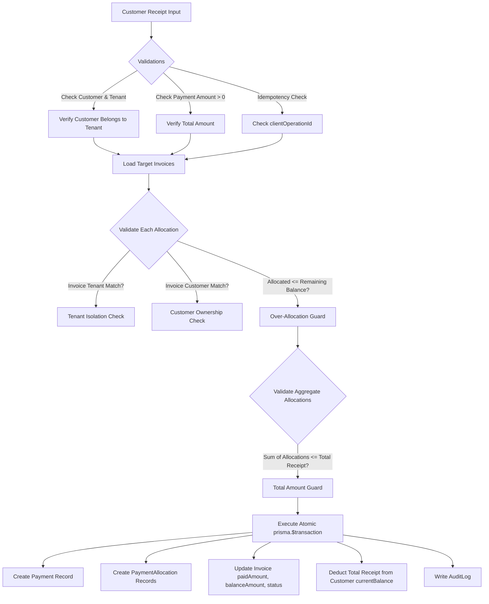
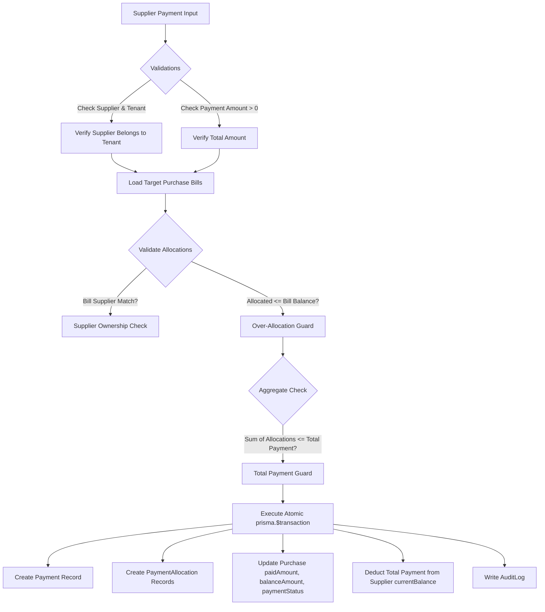

# AirthAI Payment Allocation & Expense Accounting Architecture

## 1. Accounting Framework & Architectural Principles

AirthAI's payment and expense engine implements sub-ledger accounting principles designed for Indian Micro, Small, and Medium Enterprises (MSMEs). The design guarantees financial exactness, auditability, strict separation of tenant records, and complete transaction isolation.

### 1.1 Core Principles
1. **Sub-Ledger Reconciliation:** Customer receipts credit Accounts Receivable (AR) sub-ledgers against issued sales invoices; supplier payments debit Accounts Payable (AP) sub-ledgers against verified purchase bills.
2. **Authoritative Server Verification:** Authoritative document balances, party ledgers, and allocation validity are strictly determined by the backend inside atomic database transactions (`prisma.$transaction`). Client-submitted figures are never trusted.
3. **Arbitrary-Precision Arithmetic:** All balances, allocations, payments, and expense amounts utilize PostgreSQL `DECIMAL(14, 2)` mapped to `Prisma.Decimal`. Binary IEEE-754 floating-point arithmetic is strictly forbidden in financial calculations.
4. **Idempotent Execution:** Every payment mutation supports a client-generated UUID (`clientOperationId`). Duplicate submissions due to network retries return the original record without double-crediting.
5. **Full Audit Traceability:** Every payment creation, invoice/bill allocation, payment voiding, and expense record mutation writes an unalterable `AuditLog` entry.
6. **Payment Gateway Demarcation:** Manual payment vouchers (Cash, Cheque, Bank Transfer, UPI, Card) reflect confirmed offline/sub-ledger receipts and disbursements. They do not simulate or spoof asynchronous gateway webhooks.

---

## 2. Customer Receipts & Accounts Receivable (AR)

### 2.1 Receipt Lifecycle & Document Linking
A customer receipt voucher (`Payment` entity with `paymentType = 'CUSTOMER_RECEIPT'`) represents funds received from a debtor.

### 2.2 Allocation Rules & Over-Allocation Prevention
AirthAI enforces two levels of allocation bounds:
1. **Document-Level Bound:** For each invoice $i$:
   $$0 < \text{AllocatedAmount}_i \le \text{RemainingBalance}_i$$
   where $\text{RemainingBalance}_i = \text{TotalAmount}_i - \text{PaidAmount}_i$.
   Any allocation exceeding the invoice's unpaid balance is rejected with `400 Bad Request`.
2. **Voucher-Level Bound:** Across all allocated documents:
   $$\sum_{i=1}^{k} \text{AllocatedAmount}_i \le \text{TotalPaymentAmount}$$
   Any allocation sum exceeding the payment amount is rejected with `400 Bad Request`.
3. **Unallocated Balance (Advance/On-Account):**
   $$\text{UnallocatedBalance} = \text{TotalPaymentAmount} - \sum_{i=1}^{k} \text{AllocatedAmount}_i$$
   When $\text{UnallocatedBalance} > 0$, the remaining funds stay on account as an unallocated credit, and the customer's total receivable balance is reduced by the entire payment amount.

### 2.3 Invoice Status Progression
When an invoice receives payment allocations:
- If $\text{balanceAmount} = 0$: status updates to `PAID`.
- If $\text{balanceAmount} > 0$ and $\text{paidAmount} > 0$: status updates to `PARTIALLY_PAID`.
- If an issued invoice has $\text{paidAmount} = 0$: status remains `ISSUED`.

### 2.4 Allocation Algorithms (UI & Service Layer)
The Flutter presentation layer provides an automatic **First-In, First-Out (FIFO)** distribution button alongside manual input controls:
- **FIFO Allocation:** Sorts open invoices chronologically by `dueDate` or `invoiceDate`. Sequentially assigns the payment amount up to each invoice's remaining balance until the payment amount is exhausted.
- **Manual Allocation:** Users can adjust specific allocations per invoice. Live validation ensures real-time feedback before payload submission.

---

## 3. Supplier Payments & Accounts Payable (AP)

### 3.1 Payment Lifecycle & Bill Linking
A supplier payment voucher (`Payment` entity with `paymentType = 'SUPPLIER_PAYMENT'`) represents disbursements to a creditor against confirmed purchase bills (`Purchase` entities).

### 3.2 Purchase Bill Payment Status Progression
When a purchase bill receives payment allocations:
- If $\text{balanceAmount} = 0$: `paymentStatus` becomes `PAID`.
- If $\text{balanceAmount} > 0$ and $\text{paidAmount} > 0$: `paymentStatus` becomes `PARTIALLY_PAID`.
- If $\text{paidAmount} = 0$: `paymentStatus` remains `UNPAID`.

---

## 4. Reversal & Void Mechanics (`voidPayment`)

AirthAI enforces strict financial ledger immutability. Posted payment vouchers cannot be silently updated or deleted. Instead, an authorized user may execute a **Void / Reversal** operation.

### 4.1 Void Process Within an Atomic Transaction
1. **State Verification:** Verify that the payment exists, belongs to the active tenant, and is not already voided (`isVoided = false`).
2. **Reversal of Document Allocations:**
   - For customer receipts: Find all `PaymentAllocation` records with linked `invoiceId`. Decrement each invoice's `paidAmount` and increment `balanceAmount` by the allocated amount. Recompute invoice status (`ISSUED` if `paidAmount == 0`, else `PARTIALLY_PAID`).
   - For supplier payments: Find all `PaymentAllocation` records with linked `purchaseId`. Decrement each purchase's `paidAmount` and increment `balanceAmount` by the allocated amount. Recompute `paymentStatus` (`UNPAID` if `paidAmount == 0`, else `PARTIALLY_PAID`).
3. **Reversal of Party Ledger Balances:**
   - Customer receipt void: Increment customer's `currentBalance` by the payment's `amount`.
   - Supplier payment void: Increment supplier's `currentBalance` by the payment's `amount`.
4. **Audit Trail & Marking:**
   - Mark the payment record as `isVoided = true`, set `voidReason`, and record timestamp.
   - Insert an `AuditLog` entry documenting the reversal with user ID, voucher number, and reason.

---

## 5. Expense Management Architecture

### 5.1 Category Structure & Auto-Seeding
Expenses are categorized using the `ExpenseCategory` entity scoped to each business tenant:
- **Default Categories:** Upon first accessing the expense module, the backend auto-seeds 9 standard MSME categories if none exist:
  1. *Office Supplies & Stationery*
  2. *Rent & Facilities*
  3. *Utilities (Electricity, Water, Internet)*
  4. *Salaries & Wages*
  5. *Logistics & Freight*
  6. *Marketing & Advertising*
  7. *Repairs & Maintenance*
  8. *Professional & Legal Fees*
  9. *Travel & Conveyance*
- **Custom Categories:** Businesses can define custom categories with unique names per tenant.

### 5.2 Input Tax Credit (ITC) & GST Compliance
Under Indian GST rules, registered businesses can claim Input Tax Credit (ITC) for business-related expenses if a valid tax invoice with supplier GSTIN is obtained:
- `gstAmount` cannot exceed total `amount`.
- Tax-deductible flag (`isTaxDeductible`) flags expenses eligible for income tax deduction under Section 37 of the Income Tax Act.
- Optional fields capture `vendorGstin` and `taxInvoiceNumber`.

### 5.3 Expense Deletion Policy
- Expenses can only be deleted if the tenant owner or admin authorizes it.
- Deletion is audited via `AuditLog` before record removal.
- Deletion does not mutate stock balances or party ledgers.

---

## 6. Financial Summary & Cash Flow Metrics

The module provides real-time aggregated metrics computed server-side:

### 6.1 Payment Metrics
$$\text{Net Cash Flow} = \text{Total Customer Receipts} - \text{Total Supplier Payments}$$

### 6.2 Expense Summary Metrics
- **Total Expenses:** $\sum \text{amount}$
- **Tax Deductible Expenses:** $\sum \text{amount} \text{ where } \text{isTaxDeductible} = \text{true}$
- **Total Input GST:** $\sum \text{gstAmount}$
- **Category Breakdown:** Grouped counts and aggregate sums per expense category.
