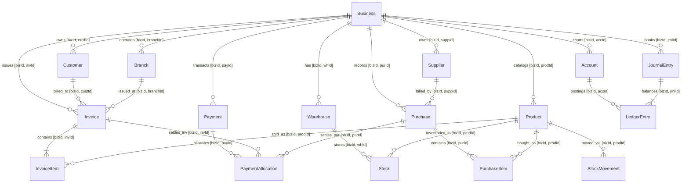
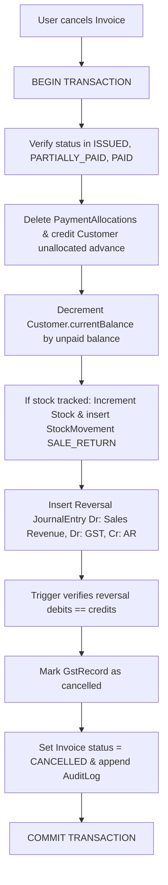

# AirthAI Database Relationships, Integrity, and Constraints

## 1. Architectural Overview

The **AirthAI MSME Business OS** database enforces strict multi-tenancy, ACID financial consistency, and double-entry accounting integrity across both the PostgreSQL server database and the Flutter Drift (SQLite) local client.

---

## 2. Entity-Relationship Diagrams

### High-Level Domain Graph



---

## 3. Multi-Tenant Cross-Referencing Armor (Composite Foreign Keys)

In standard relational schemas, a simple foreign key `FOREIGN KEY (customerId) REFERENCES Customer(id)` only checks that the customer ID exists anywhere in the database; it does not check that `Customer.businessId == Invoice.businessId`.

To eliminate cross-tenant data corruption at the database engine level, AirthAI implements **Composite Foreign Keys** where parent tables expose `@@unique([businessId, id])` and child tables enforce matching pairs `FOREIGN KEY (businessId, refId) REFERENCES Parent(businessId, id)`.

```
+-----------------------------------------------------------------------------------------------------------------------------------------------------+
|                                                  TENANT ISOLATION & COMPOSITE FOREIGN KEY MATRIX                                                    |
+--------------------------+-----------------------+----------------------------------+------------------------------------+--------------------------+
| Child Table              | Target Parent         | Child Composite FK Columns       | Referenced Parent Unique Key       | Engine-Level Action      |
+--------------------------+-----------------------+----------------------------------+------------------------------------+--------------------------+
| Branch                   | Business              | [businessId]                     | Business(id)                       | ON DELETE CASCADE        |
| BusinessSettings         | Business              | [businessId]                     | Business(id)                       | ON DELETE CASCADE        |
| Warehouse                | Business              | [businessId]                     | Business(id)                       | ON DELETE RESTRICT       |
| Warehouse                | Branch                | [businessId, branchId]           | Branch(businessId, id)             | ON DELETE RESTRICT       |
| BusinessUser             | Business              | [businessId]                     | Business(id)                       | ON DELETE CASCADE        |
| BusinessUser             | User                  | [userId]                         | User(id)                           | ON DELETE CASCADE        |
| BusinessUser             | Role (Custom Tenant)  | [businessId, roleId]             | Role(businessId, id)               | ON DELETE RESTRICT       |
| BusinessUser             | Branch (Default)      | [businessId, defaultBranchId]    | Branch(businessId, id)             | ON DELETE RESTRICT       |
| Customer                 | Business              | [businessId]                     | Business(id)                       | ON DELETE RESTRICT       |
| Supplier                 | Business              | [businessId]                     | Business(id)                       | ON DELETE RESTRICT       |
| Category                 | Business              | [businessId]                     | Business(id)                       | ON DELETE RESTRICT       |
| Unit                     | Business              | [businessId]                     | Business(id)                       | ON DELETE RESTRICT       |
| Product                  | Business              | [businessId]                     | Business(id)                       | ON DELETE RESTRICT       |
| Product                  | Category              | [businessId, categoryId]         | Category(businessId, id)           | ON DELETE RESTRICT       |
| Product                  | Unit                  | [businessId, unitId]             | Unit(businessId, id)               | ON DELETE RESTRICT       |
| ProductVariant           | Product               | [businessId, productId]          | Product(businessId, id)            | ON DELETE CASCADE        |
| Stock                    | Warehouse             | [businessId, warehouseId]        | Warehouse(businessId, id)          | ON DELETE RESTRICT       |
| Stock                    | Product               | [businessId, productId]          | Product(businessId, id)            | ON DELETE RESTRICT       |
| Stock                    | ProductVariant        | [businessId, productId, variantId| ProductVariant(biz, prodId, id)    | ON DELETE RESTRICT       |
| StockMovement            | Warehouse             | [businessId, warehouseId]        | Warehouse(businessId, id)          | ON DELETE RESTRICT       |
| StockMovement            | Product               | [businessId, productId]          | Product(businessId, id)            | ON DELETE RESTRICT       |
| Invoice                  | Business              | [businessId]                     | Business(id)                       | ON DELETE RESTRICT       |
| Invoice                  | Branch                | [businessId, branchId]           | Branch(businessId, id)             | ON DELETE RESTRICT       |
| Invoice                  | Customer              | [businessId, customerId]         | Customer(businessId, id)           | ON DELETE RESTRICT       |
| InvoiceItem              | Invoice               | [businessId, invoiceId]          | Invoice(businessId, id)            | ON DELETE CASCADE        |
| InvoiceItem              | Product (Optional)    | [businessId, productId]          | Product(businessId, id)            | ON DELETE RESTRICT       |
| Purchase                 | Business              | [businessId]                     | Business(id)                       | ON DELETE RESTRICT       |
| Purchase                 | Branch                | [businessId, branchId]           | Branch(businessId, id)             | ON DELETE RESTRICT       |
| Purchase                 | Supplier              | [businessId, supplierId]         | Supplier(businessId, id)           | ON DELETE RESTRICT       |
| PurchaseItem             | Purchase              | [businessId, purchaseId]         | Purchase(businessId, id)           | ON DELETE CASCADE        |
| PurchaseItem             | Product               | [businessId, productId]          | Product(businessId, id)            | ON DELETE RESTRICT       |
| Payment                  | Business              | [businessId]                     | Business(id)                       | ON DELETE RESTRICT       |
| Payment                  | Customer (Optional)   | [businessId, customerId]         | Customer(businessId, id)           | ON DELETE RESTRICT       |
| Payment                  | Supplier (Optional)   | [businessId, supplierId]         | Supplier(businessId, id)           | ON DELETE RESTRICT       |
| PaymentAllocation        | Payment               | [businessId, paymentId]          | Payment(businessId, id)            | ON DELETE CASCADE        |
| PaymentAllocation        | Invoice (Mutex Target) | [businessId, invoiceId]          | Invoice(businessId, id)            | ON DELETE RESTRICT       |
| PaymentAllocation        | Purchase (Mutex Target)| [businessId, purchaseId]         | Purchase(businessId, id)           | ON DELETE RESTRICT       |
| Expense                  | Business              | [businessId]                     | Business(id)                       | ON DELETE RESTRICT       |
| Expense                  | ExpenseCategory       | [businessId, categoryId]         | ExpenseCategory(businessId, id)    | ON DELETE RESTRICT       |
| Expense                  | Branch                | [businessId, branchId]           | Branch(businessId, id)             | ON DELETE RESTRICT       |
| Account                  | Business              | [businessId]                     | Business(id)                       | ON DELETE RESTRICT       |
| JournalEntry             | Business              | [businessId]                     | Business(id)                       | ON DELETE RESTRICT       |
| LedgerEntry              | JournalEntry          | [businessId, journalEntryId]     | JournalEntry(businessId, id)       | ON DELETE CASCADE        |
| LedgerEntry              | Account               | [businessId, accountId]          | Account(businessId, id)            | ON DELETE RESTRICT       |
| GstRecord                | Business              | [businessId]                     | Business(id)                       | ON DELETE RESTRICT       |
| GstRecord                | Invoice (Optional)    | [businessId, invoiceId]          | Invoice(businessId, id)            | ON DELETE RESTRICT       |
| GstRecord                | Purchase (Optional)   | [businessId, purchaseId]         | Purchase(businessId, id)           | ON DELETE RESTRICT       |
| AuditLog                 | Business              | [businessId]                     | Business(id)                       | ON DELETE RESTRICT       |
| SyncQueue                | Business              | [businessId]                     | Business(id)                       | ON DELETE CASCADE        |
+--------------------------+-----------------------+----------------------------------+------------------------------------+--------------------------+
```

---

## 4. Deletion and Audit Integrity Rules

### Non-Destructive Referencing (`ON DELETE RESTRICT`)
1. **Master Data Protection:**
   - Any `Customer`, `Supplier`, `Product`, or `Account` referenced in a commercial transaction (`Invoice`, `Purchase`, `Payment`, `LedgerEntry`, or `StockMovement`) cannot be hard-deleted. The database engine rejects the SQL delete command with code `23503`.
   - To decommission a master record, users must set `status = "ARCHIVED"` (for customers/suppliers) or `status = "INACTIVE"` (for products).
2. **Commercial History Immutability:**
   - Invoices with status `ISSUED`, `PARTIALLY_PAID`, `PAID`, or `CANCELLED` cannot be hard-deleted.
   - Deletion of an `Invoice` is only allowed when `status == DRAFT`. In this case, `ON DELETE CASCADE` removes draft line items cleanly.

---

## 5. Payment Allocation Mutex and Validation Rules

A `PaymentAllocation` distributes monetary funds from a `Payment` against a specific receivable invoice or payable purchase bill.

### Database Constraint
```sql
ALTER TABLE "payment_allocations" ADD CONSTRAINT chk_payment_alloc_mutex
CHECK (( "invoiceId" IS NOT NULL )::int + ( "purchaseId" IS NOT NULL )::int = 1);

ALTER TABLE "payment_allocations" ADD CONSTRAINT chk_payment_alloc_amount_positive
CHECK ("amount" > 0);
```

### Transactional Business Invariants
1. **Direction Agreement:**
   - If `Payment.paymentType == CUSTOMER_RECEIPT`: `invoiceId` must be non-null; `purchaseId` must be null; and `Invoice.customerId == Payment.customerId`.
   - If `Payment.paymentType == SUPPLIER_PAYMENT`: `purchaseId` must be non-null; `invoiceId` must be null; and `Purchase.supplierId == Payment.supplierId`.
2. **Allocation Capacity:**
   - $\sum \text{PaymentAllocation.amount} \le \text{Payment.amount}$. Any remainder is tracked as unallocated customer advance.
   - For any invoice: $\sum \text{PaymentAllocation.amount} \le \text{Invoice.totalAmount}$.

---

## 6. Double-Entry Accounting Invariant & Trigger

Every commercial transaction (Invoice, Payment, Purchase, Expense) writes balanced journal entries.

### Invariant
$$\sum_{i=1}^{n} \text{LedgerEntry.debit}_i = \sum_{i=1}^{n} \text{LedgerEntry.credit}_i \quad \text{for every } \text{JournalEntry}, \quad \text{where } n \ge 2$$

### PostgreSQL Deferrable Trigger Implementation
```sql
CREATE OR REPLACE FUNCTION verify_journal_entry_balanced()
RETURNS TRIGGER AS $$
DECLARE
  v_journal_id UUID;
  v_total_debit NUMERIC(14, 2);
  v_total_credit NUMERIC(14, 2);
  v_entry_count INTEGER;
BEGIN
  IF TG_OP = 'DELETE' THEN
    v_journal_id := OLD."journalEntryId";
  ELSE
    v_journal_id := NEW."journalEntryId";
  END IF;

  SELECT
    COALESCE(SUM(debit), 0.00),
    COALESCE(SUM(credit), 0.00),
    COUNT(*)
  INTO v_total_debit, v_total_credit, v_entry_count
  FROM "ledger_entries"
  WHERE "journalEntryId" = v_journal_id;

  IF EXISTS (SELECT 1 FROM "journal_entries" WHERE "id" = v_journal_id) THEN
    IF v_entry_count < 2 THEN
      RAISE EXCEPTION 'Journal entry % must contain at least 2 ledger entries, found %',
        v_journal_id, v_entry_count;
    END IF;

    IF v_total_debit <> v_total_credit THEN
      RAISE EXCEPTION 'Journal entry % is unbalanced: Total Debits (%) != Total Credits (%)',
        v_journal_id, v_total_debit, v_total_credit;
    END IF;
  END IF;

  IF TG_OP = 'UPDATE' AND OLD."journalEntryId" IS DISTINCT FROM NEW."journalEntryId" THEN
    SELECT
      COALESCE(SUM(debit), 0.00),
      COALESCE(SUM(credit), 0.00),
      COUNT(*)
    INTO v_total_debit, v_total_credit, v_entry_count
    FROM "ledger_entries"
    WHERE "journalEntryId" = OLD."journalEntryId";

    IF EXISTS (SELECT 1 FROM "journal_entries" WHERE "id" = OLD."journalEntryId") THEN
      IF v_entry_count < 2 THEN
        RAISE EXCEPTION 'Journal entry % must contain at least 2 ledger entries, found %',
          OLD."journalEntryId", v_entry_count;
      END IF;

      IF v_total_debit <> v_total_credit THEN
        RAISE EXCEPTION 'Journal entry % is unbalanced: Total Debits (%) != Total Credits (%)',
          OLD."journalEntryId", v_total_debit, v_total_credit;
      END IF;
    END IF;
  END IF;

  RETURN NULL;
END;
$$ LANGUAGE plpgsql;

CREATE CONSTRAINT TRIGGER trg_verify_journal_entry_balanced
AFTER INSERT OR UPDATE OR DELETE ON "ledger_entries"
DEFERRABLE INITIALLY DEFERRED
FOR EACH ROW EXECUTE FUNCTION verify_journal_entry_balanced();
```

---

## 7. Inventory Policy and Concurrency Protection

1. **Decoupled Architecture:**
   - `BusinessSettings.trackInventory`: Global merchant toggle.
   - `Product.trackStock`: Item-level toggle (`false` for service items).
   - `Product.itemType`: When `SERVICE`, `trackStock` is strictly forced to `false`.
2. **Negative Stock Policy:**
   - `BusinessSettings.allowNegativeStock = false` by default.
   - When negative stock is forbidden, stock decrement inside the invoice transaction runs:
     ```sql
     SELECT "quantityOnHand" FROM "stocks"
     WHERE "businessId" = $1 AND "warehouseId" = $2 AND "productId" = $3
     FOR UPDATE;
     ```
     If `quantityOnHand < saleQty`, the entire transaction aborts with `INSUFFICIENT_STOCK`.
3. **Preservation of History:**
   - Disabling `trackInventory` stops future stock checks and stops writing to `stock_movements`, but **never** deletes or truncates historical rows.

---

## 8. GST Lifecycle, Document Sequences, and Cancellation

### GST Registration-Driven Configuration
During business onboarding, `enableGst` and tax behaviors are initialized by `Business.taxType`:
- `UNREGISTERED`: `enableGst = false`, default GST rate = 0.00%. Generates cash receipts / simple bills without tax split.
- `COMPOSITION`: `enableGst = true`, fixed turnover tax (1% or 5%), no tax charged to customer on bills, bill title = "Composition Bill of Supply", no Input Tax Credit (ITC).
- `REGULAR`: `enableGst = true`, full multi-tier CGST/SGST/IGST tax breakdown, HSN/SAC codes, full ITC on inward purchases.

### Safe Document Numbering Engine
To guarantee unique sequential invoice numbering without collisions under multi-counter concurrency:
```sql
SELECT "nextNumber" FROM "document_sequences"
WHERE "businessId" = $1 AND "documentType" = 'INVOICE' AND "fiscalYear" = $2
FOR UPDATE;

UPDATE "document_sequences"
SET "nextNumber" = "nextNumber" + 1
WHERE "businessId" = $1 AND "documentType" = 'INVOICE' AND "fiscalYear" = $2;
```
*Note on Gapless Numbering:* Document sequences are strictly transactional and unique (`@@unique([businessId, invoiceNumber])`). Once an invoice is issued and subsequently cancelled, that invoice number is consumed and preserved on the cancelled document to satisfy tax audit laws. Sequences are not rolled back on cancelled documents.

### Atomic Invoice Cancellation Pipeline
When an invoice is cancelled, all subsystems are reversed in one atomic transaction:


---

## 9. PostgreSQL Raw Migration Scripts (`migration.sql`)

The following SQL commands complement `schema.prisma` and must be executed in the initial database migration:

```sql
-- Partial Unique Indexes
CREATE UNIQUE INDEX invoice_client_op_idx ON "invoices" ("businessId", "clientOperationId") WHERE "clientOperationId" IS NOT NULL;
CREATE UNIQUE INDEX payment_client_op_idx ON "payments" ("businessId", "clientOperationId") WHERE "clientOperationId" IS NOT NULL;
CREATE UNIQUE INDEX purchase_client_op_idx ON "purchases" ("businessId", "clientOperationId") WHERE "clientOperationId" IS NOT NULL;

CREATE UNIQUE INDEX role_system_name_idx ON "roles" ("name") WHERE "businessId" IS NULL;
CREATE UNIQUE INDEX role_tenant_name_idx ON "roles" ("businessId", "name") WHERE "businessId" IS NOT NULL;

CREATE UNIQUE INDEX stock_no_variant_idx ON "stocks" ("warehouseId", "productId") WHERE "variantId" IS NULL;
CREATE UNIQUE INDEX stock_with_variant_idx ON "stocks" ("warehouseId", "productId", "variantId") WHERE "variantId" IS NOT NULL;

-- Table CHECK Constraints
ALTER TABLE "payment_allocations" ADD CONSTRAINT chk_payment_alloc_mutex
CHECK (( "invoiceId" IS NOT NULL )::int + ( "purchaseId" IS NOT NULL )::int = 1);

ALTER TABLE "payment_allocations" ADD CONSTRAINT chk_payment_alloc_amount_positive
CHECK ("amount" > 0);

ALTER TABLE "gst_records" ADD CONSTRAINT chk_gst_record_mutex
CHECK (( "invoiceId" IS NOT NULL )::int + ( "purchaseId" IS NOT NULL )::int = 1);

ALTER TABLE "invoice_items" ADD CONSTRAINT chk_invoice_item_qty_positive CHECK ("quantity" > 0);
ALTER TABLE "invoice_items" ADD CONSTRAINT chk_invoice_item_price_non_negative CHECK ("unitPrice" >= 0);
ALTER TABLE "ledger_entries" ADD CONSTRAINT chk_ledger_entry_non_negative CHECK ("debit" >= 0 AND "credit" >= 0 AND ("debit" > 0 OR "credit" > 0));
```
